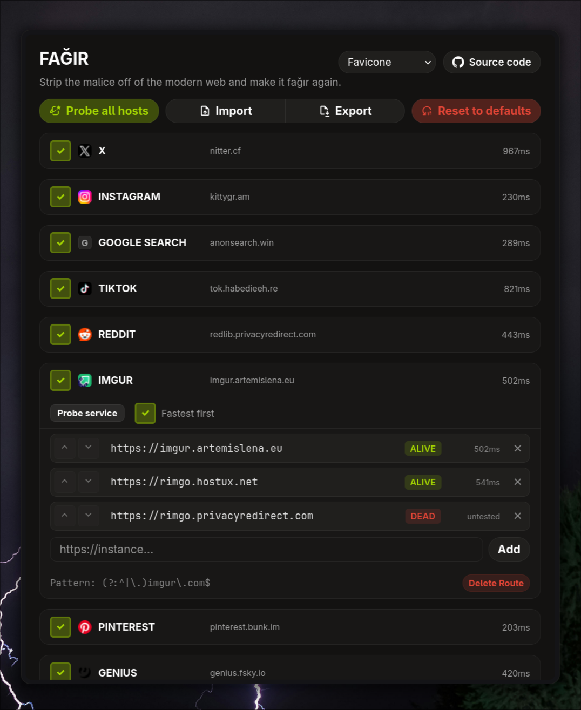

# FAĞIR

Strip the malice off of the modern web and make it fağır again.

### What?

Basically, an extension, specifically made for firefox, that let's you escape the tracking hell that the modern web has become.

### Why?

Fağır supports many quality of life features that other alternatives lack. In fact, that's the reason why I made this. There a really good extensions and userscript made by talented open-sourcers, but most features I was looking for were nonexistent.

### How?

- Fağır let's you `probe` all instances you defined to see if they are alive and what's the latency for each of them.
- It let's you sort all instances per service to be sorted by latency, making your experience as seamless as possible.
- It has import/export baked in, so that you can share your list of instances with others and vice versa.
- It let's you skip to the next instance for the service that you are currently in an instance of. This helps when an instance is "alive" but internally is rate limited, you can just go to the next instance with a single click.
- It let's you temporarily disable a service from being forwarded to a privacy-friendly alternative in case something breaks.
- It let's you add regex based matching and forwarding rules.
- It is incredibly small and fast. It has no dependency besides vanjs, which itself is incredibly small as well.

## TODO
- [x] Import & Export
- [x] Health check for hosts
- [x] Per-service health checking
- [x] Disabling services instead of having to delete
- [x] Reset to defaults functionality
- [x] Next instance button for internally broken instances where url is already consumed and manual labor is needed
- [x] Sort by latency
- [x] Privacy-first favicon service(s) for better clarity on menu
- [x] Customizable favicon domains since some websites does not host assets on A record domains for some reason
- [ ] Add github actions based automatic weekly instance harvesting and hosting
- [ ] Github repo based automatic fresh instance gathering
- [ ] Make UI layout more tolerable
- [ ] Get the extension available on mozilla addons
- [ ] Tidy-up and unspaghettify the codebase